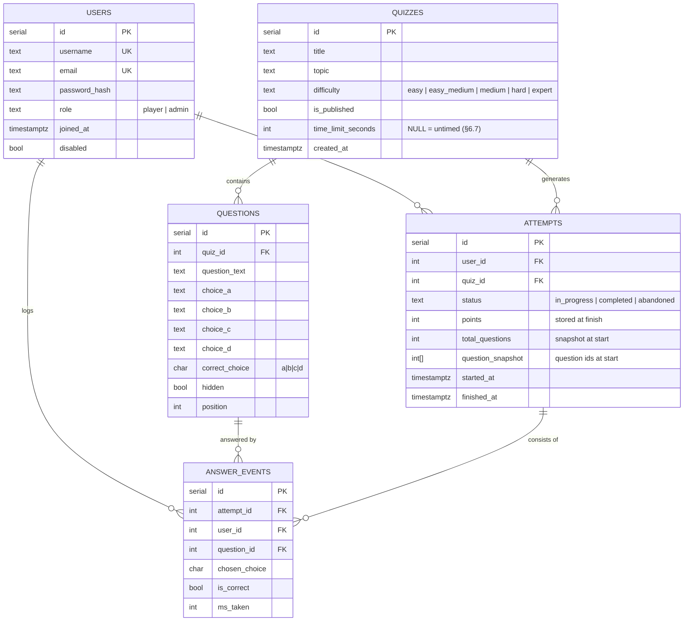

# Quiz App — Product & Engineering Specification

**Owner:** Alexander Gomez-Ewert · **Status:** Draft for implementation · **Stack:** HTML/CSS, JavaScript, Node.js, Express, PostgreSQL

A consolidated spec from the planning work: content plan, UX flows, page designs, feature definitions, and leaderboard rules.

---

## 1. Overview

A web quiz app for casual players (friends): five general-knowledge quizzes ramping from easy to expert. Players register, take quizzes, track their history, and compete on leaderboards. A teacher/admin persona manages quizzes, questions, and users, and reviews usage analytics.

### Core features (required)
- Register / log in (hashed passwords)
- Browse 5 quizzes, take a quiz (4 choices, 1 correct), view results, retry
- Attempt history per user

### Functional features beyond the core
> Leaderboards are **required by the assignment** and therefore part of the shared requirements, not one of the two extra features. The two additional functional features are:

1. **Timed quiz mode** — per-quiz time limit with server-verified enforcement; rules in §6.7. **CONFIRMED.**
2. **Per-question analytics** — attempt/score aggregates and per-question miss rates powering the admin stats page; spec in §7. **CONFIRMED.**

> The admin CSV import (§8) and question editor UI (§9) are **not** additional features — they are part of the core admin tooling for managing quiz content.

---

## 2. Personas

| Persona | Goals | Key flows |
|---|---|---|
| New player | Sign up, take first quiz, see score | Landing → Register → Dashboard (first-run) → Play → Results → Leaderboard |
| Returning player | Beat previous scores, track progress | Login → Dashboard (resume/best prompts) → Play → Results (delta vs. previous) → History |
| Teacher / Admin | Manage content & users, review stats | Admin area: quizzes/questions CRUD, CSV import, user roles, usage analytics |

---

## 3. Data model (PostgreSQL)



Key invariants:
- `attempts.points` and `total_questions` are **immutable after finish**; scores are never recomputed from edited questions (§6-C2).
- `attempts.question_snapshot` stores the question set at start (§6-U4).
- `answer_events` powers per-question analytics; one row per answered question.

---

## 4. API routes (Express)

| Method | Route | Access | Purpose |
|---|---|---|---|
| POST | `/api/auth/register` | public | Create account |
| POST | `/api/auth/login` | public | Start session (signed session cookie, see below) |
| POST | `/api/auth/logout` | auth | End session |
| GET | `/api/quizzes` | auth | List quizzes (published only) |
| GET | `/api/quizzes/:id` | auth | Quiz detail incl. question count |
| POST | `/api/quizzes/:id/attempts` | auth | Start attempt → returns snapshot + attempt id |
| PATCH | `/api/attempts/:id` | auth (owner) | Save answers / resume |
| POST | `/api/attempts/:id/finish` | auth (owner) | Submit → computes points, sets completed |
| POST | `/api/attempts/:id/abandon` | auth (owner) | Mark abandoned |
| GET | `/api/attempts/:id/results` | auth (owner) | Per-question breakdown |
| GET | `/api/me/attempts` | auth | Attempt history |
| GET | `/api/leaderboard/overall` | auth | Overall board (§6-O) |
| GET | `/api/leaderboard/quizzes/:id` | auth | Per-quiz board (§6-Q) |
| PATCH | `/api/me` | auth | Update profile / password |
| — | `/api/admin/*` | **admin role enforced server-side** | Quizzes/questions CRUD, CSV import, users, stats |

Server-side rules: every attempt route checks ownership; admin routes check `role='admin'`; guest play is rejected (§6-A1).

**Session mechanism (DECIDED):** signed **session cookie** (e.g. `express-session` with a cookie signed by a server secret), not JWTs. Rationale: simpler to revoke (destroy on logout), no token expiry/refresh logic, and role changes take effect on the next request without token reissuing. Cookie: `httpOnly`, `SameSite=Lax`, secure in production; session lifetime 7 days (sliding: refreshed on activity).

**Admin bootstrap (DECIDED):** a seed script (`npm run seed` / `seed.js`) inserts the five quizzes, their questions, and the first admin account (username + password from environment variables, e.g. `ADMIN_USERNAME`/`ADMIN_PASSWORD`, hashed at seed time). Registration always creates `role='player'`; no API path can grant admin — the only ways to become admin are the seed script or a manual DB update by an existing admin. The Admin Users page can then promote/demote others (§6-A6).

**Admin user management (DECIDED — Admin Users page scope):**
- **See:** username, email, role, disabled status, total completed attempts, quizzes played, joined date.
- **See (drill-down):** any user's attempt history (read-only: quiz, date, score, status).
- **Edit:** promote to admin / revoke admin; disable / re-enable account (disabled users cannot log in or start attempts; existing entries stay per §6-A5).
- **Cannot:** view or reset another user's password, delete another user's account (v1 — account deletion is self-service only, §6-A3), edit usernames/emails.
- **Self-protection:** an admin cannot revoke their own admin role or disable their own account (enforced server-side).

---

## 5. Page inventory & design language

Pages: Landing, Log In, Register, Dashboard, Quiz List, Quiz Play, Results, History, Leaderboard, Profile, Admin Home, Admin Quizzes, Admin Users, Admin Stats.

**Design language:** light background `#F7F8FA`, white cards, indigo `#4F46E5` accent reserved for the single primary action per screen. Difficulty colors: Easy=green, Easy–Medium=teal, Medium=amber, Hard=orange, Expert=red. 8px spacing grid; content max-width 1080px. Feedback: toasts (transient), inline alerts (form errors), dialogs (destructive confirmations only). Mobile: header nav → bottom tab bar (Home, Quizzes, Leaderboard, History); every table degrades to stacked cards; tap targets ≥ 44px.

Per-page UI specifications (header, nav, forms, buttons, cards, tables, messages, spacing, mobile) are defined in the **Quiz App Page-by-Page UI Design** document; the navigation inventory and persona walkthroughs are in the **Quiz App UX & Navigation Design** document. This spec defers to those for screen-level detail.

---

## 6. Leaderboard rules (normative)

### 6.1 Definitions
- **Attempt:** `in_progress`, `completed`, or `abandoned`. Completed = final submit clicked, or time limit expired per §6.7 (unanswered questions score 0).
- **Score:** correct-answer count, stored on the attempt at finish. **Percentage** = points ÷ total_questions, display only.
- **Best score:** max points across a user's completed attempts of that quiz.

### 6.2 Overall leaderboard
| # | Rule |
|---|---|
| O-1 | Rank by total completed attempts (all quizzes), highest first. |
| O-2 | Only users with ≥ 1 completed attempt appear. |
| O-3 | Ties share rank; standard competition ranking (1, 2, 2, 4). |
| O-4 | Tied users display in username order (deterministic). |
| O-5 | All-time scope; no time windows in v1. |

### 6.3 Per-quiz leaderboard
| # | Rule |
|---|---|
| Q-1 | Rank by best score (points), highest first. |
| Q-2 | Only users with ≥ 1 completed attempt of that quiz appear. |
| Q-3 | Same points → shared rank (1, 2, 2, 4). |
| Q-4 | Tie-break 1: earlier `best_achieved_at` ranks higher (first to reach the score). |
| Q-5 | Tie-break 2: fewer completed attempts of that quiz ranks higher. |
| Q-6 | Tie-break 3: username alphabetical. |
| Q-7 | Percentage displayed, never a ranking key. |
| Q-8 | `attempts` column = completed attempts only. |

### 6.4 Retries
| # | Rule |
|---|---|
| R-1 | Every completed attempt increments the attempt count, even if worse. |
| R-2 | Best score updates only when strictly greater. |
| R-3 | `best_achieved_at` = the finish time of the first attempt reaching the best. |
| R-4 | Retries never delete or hide earlier attempts. |

### 6.5 Unfinished attempts
| # | Rule |
|---|---|
| U-1 | `in_progress` attempts count nowhere. |
| U-2 | Resumed attempts that finish count once, as completed. |
| U-3 | Abandoned attempts never count and cannot be resumed. |
| U-4 | In-progress attempts complete against their start-time question snapshot. |

### 6.6 Users & content changes
| # | Rule |
|---|---|
| A-1 | Logged-in users only; no guest entries. |
| A-2 | Admins rank as normal players. |
| A-3 | Account deletion (self-service, from Profile) removes the user and their entries from all boards. Admins cannot delete other users (§4). |
| A-4 | Username changes update display only (rankings keyed on user id). |
| A-5 | Disabled accounts stay ranked but cannot start new attempts. |
| A-6 | An admin cannot revoke their own admin role or disable their own account (server-enforced self-protection). |
| C-1 | Unpublishing a quiz hides its per-quiz board; overall counts remain. |
| C-2 | Editing/deleting questions never recomputes past scores. |
| C-3 | Admins are warned that changing a quiz's question count mid-competition makes leaderboard points incomparable. |

### 6.7 Timed quiz mode (feature — normative)

| # | Rule |
|---|---|
| T-1 | Time limit is **per quiz**, set by the admin in the quiz editor (`time_limit_seconds`, NULL = untimed). Five default values used in content: none (Quizzes 1–2) and 10–15 min for harder quizzes; admin can change per quiz. |
| T-2 | The clock starts when the attempt is created (`started_at`) and counts **total elapsed time**, not per-question time. Pausing is not supported in v1. |
| T-3 | The client shows a countdown chip; at 0 it auto-submits via the normal finish endpoint. The client display is advisory only. |
| T-4 | The **server** is the source of truth: on finish, the server computes elapsed = `finished_at - started_at`. If elapsed > limit + 10s grace (clock skew tolerance), the attempt is marked completed with the answers received so far; unanswered questions score 0. |
| T-5 | Answers saved after the deadline are rejected (finish request accepted, late answer payloads ignored). |
| T-6 | Time expired counts as a completed attempt (§6.1) for all leaderboard rules — same retry rules (§6.4). |
| T-7 | Resuming an in-progress attempt (§6.5-U2) does **not** pause the clock; elapsed time continues from `started_at`. The resume screen warns "Time is still running" with remaining time. |
| T-8 | "Time taken" is **derived, not stored**: elapsed = `finished_at - started_at` on the attempts table. No separate time-taken column exists. Results and history display this derived value; untimed attempts show it without a limit. |

**Test cases:** attempt finishes at limit+5s grace → answers accepted, completed; finish at limit+60s → only pre-deadline answers counted; resume after deadline → shows expired, forced finish; untimed quiz → no chip, no enforcement.
### 6.8 Display

- Per-quiz row: rank (medals top 3), avatar + username, "8/10 · 80%", attempts, date of best.
- Overall row: rank, avatar + username, total completed attempts, quizzes played, member since.
- Top 10 shown; current user highlighted with "You" badge; sticky "Your best: #14" callout when outside the visible list.

### 6.9 Reference queries

```sql
-- Per-quiz board: best score per user, first-achieved tie-break
WITH best AS (
  SELECT DISTINCT ON (user_id)
         user_id, points, finished_at AS best_achieved_at
  FROM attempts
  WHERE quiz_id = $1 AND status = 'completed'
  ORDER BY user_id, points DESC, finished_at ASC
)
SELECT u.id, u.username, b.points AS best_points, b.best_achieved_at,
       COUNT(a.id) AS attempts
FROM best b
JOIN users u ON u.id = b.user_id
LEFT JOIN attempts a ON a.user_id = b.user_id AND a.quiz_id = $1 AND a.status = 'completed'
GROUP BY u.id, u.username, b.points, b.best_achieved_at
ORDER BY b.points DESC, b.best_achieved_at ASC, COUNT(a.id) ASC, u.username ASC
LIMIT $2;

-- Overall board
SELECT u.id, u.username, COUNT(a.id) AS total_attempts,
       COUNT(DISTINCT a.quiz_id) AS quizzes_played, MIN(a.finished_at) AS first_at
FROM users u
JOIN attempts a ON a.user_id = u.id AND a.status = 'completed'
GROUP BY u.id, u.username
ORDER BY total_attempts DESC, u.username ASC
LIMIT $1;
```

Competition rank is computed post-query: rank = 1 + number of users strictly ahead by the ordering key.

---

## 7. Analytics (feature 2)

Aggregates computed from `attempts` and `answer_events` (read-only admin pages):

- **Overview:** total users, attempts today, average score, most-missed question.
- **Trends:** attempts per day (line), score distribution (bar), miss rate per question — top 10 worst (horizontal bar).
- **Per-quiz table:** attempts, avg %, avg time, trend vs. previous period.
- Filters: date range, quiz. Empty states when a range has no data.

```sql
-- Miss rate per question
SELECT q.id, LEFT(q.question_text, 60) AS question,
       COUNT(*) AS times_answered,
       ROUND(100.0 * SUM(CASE WHEN e.is_correct THEN 0 ELSE 1 END) / COUNT(*), 1) AS miss_rate
FROM answer_events e
JOIN questions q ON q.id = e.question_id
GROUP BY q.id
ORDER BY miss_rate DESC, times_answered DESC
LIMIT 10;
```

---

## 8. CSV question import (admin)

### 8.1 File requirements
- Upload: single `.csv` file, UTF-8, max 5 MB, max 500 rows.
- Accept both CRLF and LF. First row must be the header row.
- Target quiz is chosen from a dropdown before import (import never creates quizzes).

### 8.2 CSV template — exact column headers (case-insensitive, order-insensitive)

| Header | Required | Type | Validation |
|---|---|---|---|
| `question` | yes | text | 3–500 chars after trim; non-empty |
| `choice_a` | yes | text | 1–200 chars |
| `choice_b` | yes | text | 1–200 chars |
| `choice_c` | yes | text | 1–200 chars |
| `choice_d` | yes | text | 1–200 chars |
| `correct` | yes | enum | exactly one of `A`, `B`, `C`, `D` (case-insensitive) |
| `position` | no | integer | ≥ 1; if omitted, rows append in file order after existing questions |

Rules: unknown columns → row-level warning, ignored. Missing any required header → **whole-file error**, nothing imported (fail fast, before row parsing). Whitespace is trimmed on all values. BOM stripped.

### 8.3 Row-level validation rules
1. `correct` must be exactly one of A/B/C/D (empty or "ab" → row error).
2. No duplicate text within a row's choices is an error ("a" and "A" count as duplicates).
3. Duplicate question text already exists in the target quiz → row is **skipped (warning)**, not an error.
4. Empty row → skipped silently.
5. Malformed CSV (unclosed quote, wrong column count in a row) → row error with the detected column count.

### 8.4 Import flow (preview-then-commit)
1. Admin selects quiz → chooses file → clicks **Preview Import** (upload parses server-side, nothing saved yet).
2. Preview screen shows a summary card: `X valid · Y duplicates skipped · Z errors`, then a **table of the first 20 parsed rows** (question truncated to 60 chars, A–D, correct letter highlighted) and an **error panel**: one line per bad row — `Row 7: "correct" must be A, B, C, or D` — bad rows excluded.
3. Buttons: **Import N Questions** (primary, N = valid count; disabled if N = 0), **Download error report (CSV)** (row number + reason), **Cancel**.
4. On commit: single transaction; rows inserted in `position` order; success toast `N questions added, Y skipped`; redirect to the quiz's question list.

### 8.5 API
| Method | Route | Access |
|---|---|---|
| POST | `/api/admin/quizzes/:id/import/preview` | admin — body: multipart file → returns summary + up to 20 preview rows + all errors |
| POST | `/api/admin/quizzes/:id/import/commit` | admin — body: the validated rows (server revalidates; never trusts client) |

**Test cases:** header typo → whole-file error; row with `correct=E` → one row error, others import; duplicate of existing question → skipped with warning; 500-row cap; commit without preview → 400.

---

## 9. Admin question editor (UI flow & fields)

### 9.1 Entry points
- Admin → Quizzes (`/admin/quizzes`) → **Edit** on a quiz row → question list → **+ Add Question** or **Edit** on a question row.

### 9.2 Question list view (top of editor)
Quiz meta form: Title, Topic (text), Difficulty (select: Easy / Easy–Medium / Medium / Hard / Expert), Time limit (minutes, empty = untimed, per §6.7-T1), Published toggle, **Save** (secondary). Below: table — `#`, Question (truncated 60 chars), Correct (letter), Status (Active / Hidden badge), Actions: **Edit**, **Hide/Show** (quiet), **Delete** (danger).

### 9.3 Add / edit question form (same form for both)
Opened as an inline card under the list (not a modal — long question text needs room). Fields:

| Field | Control | Validation |
|---|---|---|
| Question text | textarea, 4 rows, placeholder "Enter the question" | required, 3–500 chars, live character counter |
| Choice A–D | four text inputs, each prefixed with its letter chip (A/B/C/D) | required, 1–200 chars each; duplicates within the form flagged inline ("Choice C is identical to Choice A") |
| Correct answer | radio group beside/under each choice input ("This is the correct answer" radio per row) — exactly one selectable | required, exactly one; form cannot submit with zero selected |
| Position | number input (optional) | ≥ 1; default = next available |

Buttons: **Save Question** (primary; disabled until valid), **Cancel** (quiet). On edit, the form is pre-filled and the header shows "Editing Q7 — Back in Time".

### 9.4 Behavior & messages
- Inline validation on blur; errors under each field, red border; no browser dialogs.
- Save → toast "Question added" / "Question updated", list refreshes, form clears (add mode) or closes (edit mode).
- **Delete with attempt history** (`answer_events` exist for the question): confirm dialog offers two options — **Hide** (recommended, default focus: question stays in history, excluded from new attempts) or **Delete anyway** (destructive: removes question + its answer events; historical attempt points are NOT recomputed per §6-C2). Deleting with no history: standard confirm dialog.
- No question set changes ever recompute past scores (§6-C2/C-3 warning banner shows on the quiz editor when attempts exist: "Editing questions mid-competition makes leaderboard points incomparable").

**Test cases:** submit with no correct radio → blocked; duplicate choices → inline error; delete with history → dialog offers Hide first; position conflicts → auto-renumber on save.

## 10. Acceptance tests (leaderboard, normative)

1. Complete 8/10 → per-quiz entry at 8 points, attempts = 1.
2. Retry scoring 6/10 → best stays 8/10, attempts = 2, rank unchanged.
3. Retry scoring 10/10 → best 10/10 with that attempt's finish time, rank improves.
4. Two users at 8/10 → the earlier achiever ranks higher (Q-4).
5. Quit mid-quiz → resumable, no counts; discard → abandoned, never counted.
6. Resume in-progress → finish → counts exactly once.
7. Zero completed attempts → absent from both boards.
8. Tied overall counts → ranks 1, 2, 2, 4.
9. Delete a question → historical scores unchanged (C-2).
10. Guest attempt request → 401, no entry (A-1).
11. User outside top 10 → callout rank matches Q-4 ordering.
12. Identical data, repeated query → identical order (determinism).

Additional suites to write before implementation: auth (register/login/role gates), play flow (snapshot, resume, finish scoring), history (filters, retry from row), admin CRUD + CSV import validation, analytics aggregation vs. seed data.

---

## 11. Open items

| Item | Status |
|---|---|
| ~~Final choice of the two extra features~~ | **CONFIRMED: Timed quiz mode (§6.7) + per-question analytics (§7).** Leaderboards are a shared/required assignment feature (§6). |
| Session mechanism | **DECIDED: signed session cookie** (httpOnly, SameSite=Lax, 7-day sliding) |
| Admin bootstrap | **DECIDED: seed script** creates first admin from env vars; registration always creates players |
| Admin user management scope | **Specified (§4)** — see/edit rules, self-protection, no password resets, no admin deletions |
| Timer rules | **Specified (§6.7, T-1–T-8)** — server-verified elapsed time, 10s grace |
| CSV import template, validation, preview flow | **Specified (§8)** |
| Admin question editor UI flow & fields | **Specified (§9)** |
| Theme (indigo/light default) | Set as default; swappable |
| Forgot-password flow | Marked optional; not spec'd |
| Quiz difficulty colors | **CONFIRMED: Easy=green, Easy–Medium=teal, Medium=amber, Hard=orange, Expert=red** |